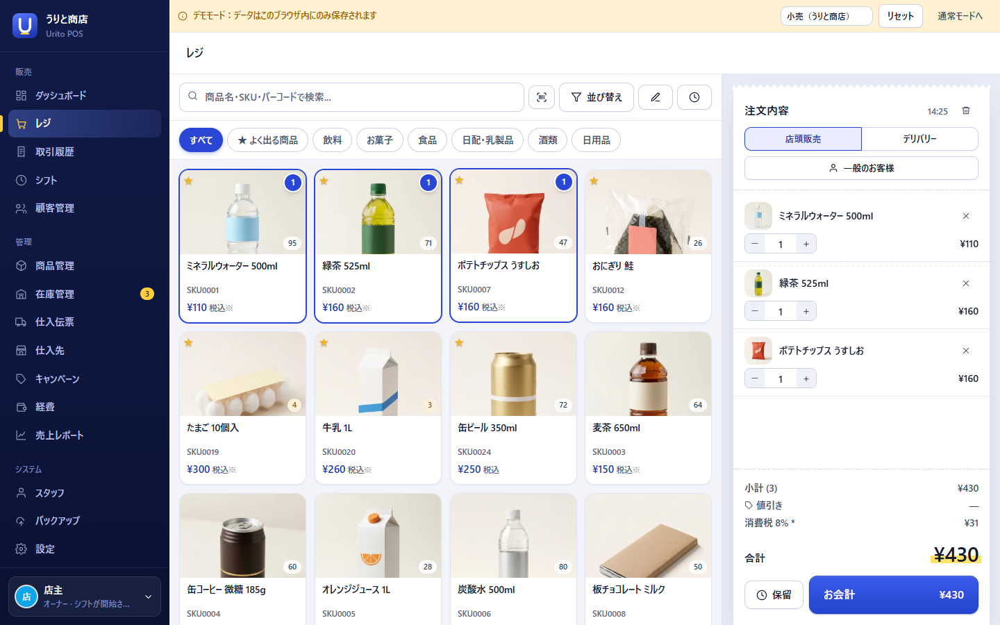

# Urito POS

[日本語](README.md) | [Tiếng Việt](README.vi.md) | [Feature Registry (JA)](docs/ja/features.md) | [Architecture (JA)](docs/ja/architecture.md) | [Benchmarks (JA)](docs/perf/benchmark.md)

## Overview

**Urito POS** is an open-source, **offline-first, zero-server browser POS (PWA)** built for small retail shops, cafes, and restaurants.  
All sales, catalog items, stock movements, customer balances, shifts, and thermal receipts live atomically inside browser IndexedDB (`Dexie 4`) with zero monthly server cost.

## Demo Modes

Append `?demo=<scenario>` to launch an isolated `urito-demo` database without modifying live store data:

- **Retail (`ja-retail` or `1`)**: `?demo=ja-retail#/pos` — 12 barcode goods, mixed 8% reduced food & 10% standard tax, 30 days of historical orders
- **Cafe (`ja-cafe`)**: `?demo=ja-cafe#/pos` — drink modifiers and eat-in (10%) vs takeaway (8%) switching
- **Diner (`ja-restaurant`)**: `?demo=ja-restaurant#/pos` — table floor management, parked tickets, split/move orders, and Ryoshusho receipts

## Screenshots



## Key Capabilities & Engineering

- **Japan Tax & Invoice Compliance**: Product-level 8% / 10% / Exempt tax rates, eat-in switching, `T` + 13-digit Qualified Invoice ID, `※` reduced-tax indicators, rate subtotals on 80mm / 58mm rolls, and `Ryoshusho` formal receipt generation with revenue stamp box (`>= ¥50,000`).
- **100k-Order Scale Performance (measured at CDP 4x CPU throttle)**:
  - **200 products · 1,000 orders**: `211 ms` cold POS load, `88 ms` search, `820 ms` 10-line checkout, `280 ms` 1-year report switch
  - **5,000 products · 100,000 orders**: `340 ms` cold POS load, `127 ms` search, `944 ms` 10-line checkout (`0` image DB reads), `288 ms` 1-year report switch, `6,060 ms` (`7.2 MB`) streaming gzip backup at `34.1 MB` heap
- **Cross-Border EC & Multicurrency**: Bidirectional Shopify product CSV import/export, `product.i18n` / `product.prices` (JPY/USD/VND), manual exchange-rate price suggestion, idempotent (`[channel+externalId]`) EC order CSV import, barcode fallback, and a persistent pending SKU mapping queue.
- **Security & Offline Durability**: PBKDF2-SHA256 salted PIN auth (150k iterations + 5-attempt lockout), strict cache-first Service Worker precaching with cart-guarded update prompts, File System Access folder sync (`images/` differential sync + streaming `.json.gz`), and full `.urito.json` single-file backup/restore.

## Commands

```bash
npm install
npm run dev                  # Dev server (http://localhost:5173)
npm run typecheck            # TypeScript check
npm run lint                 # ESLint + jsx-a11y + react-hooks
npm test                     # Vitest unit, migration & fast-check property tests (112 tests)
npm run build                # Production PWA build (Japanese default + dist/sw.js)
node scripts/check-size.mjs  # Verify bundle size budgets (perf-budget.json)
npm run docs:features        # Sync feature table to docs/ja/features.md & README.md
npm run build:showcase       # Combine LP (site/) + POS (/app/) -> dist-showcase/
npm run build:netlify        # Production build + zip for Netlify manual deploy
node scripts/e2e/offline-sw.mjs  # Playwright offline & SW update E2E
node scripts/e2e/a11y-audit.mjs  # Playwright + axe-core WCAG audit (24 matrix checks)
```

## License

[MIT License](LICENSE) — Copyright (c) 2026 Urito Contributors
