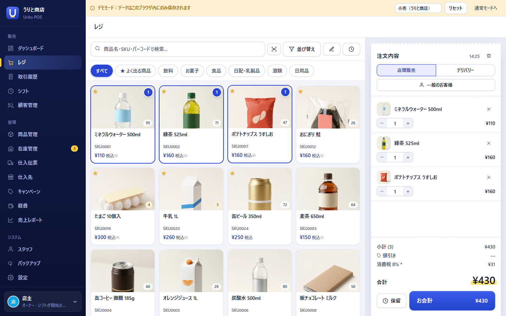
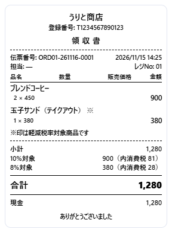
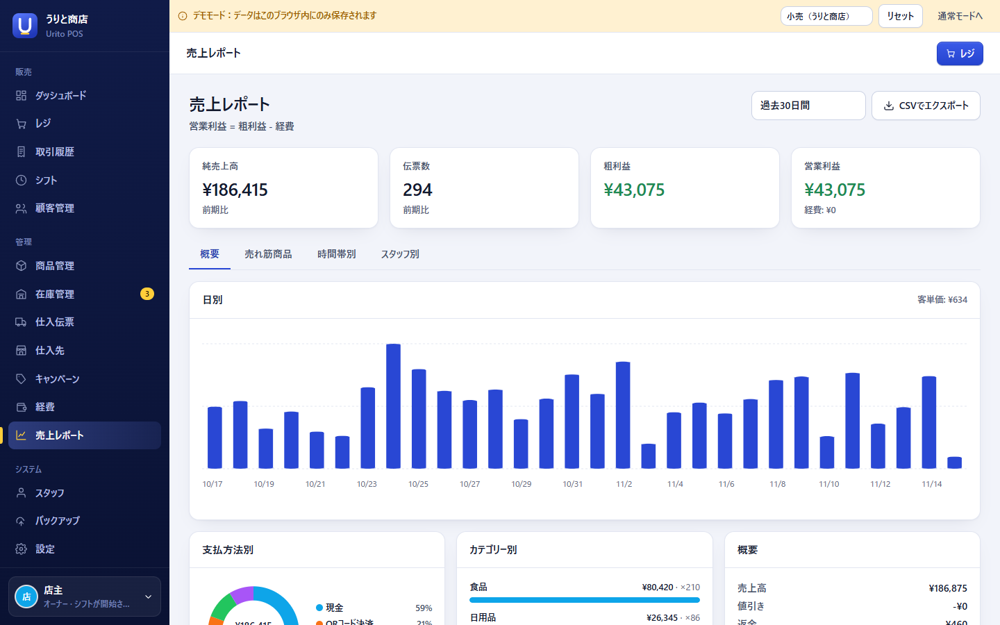
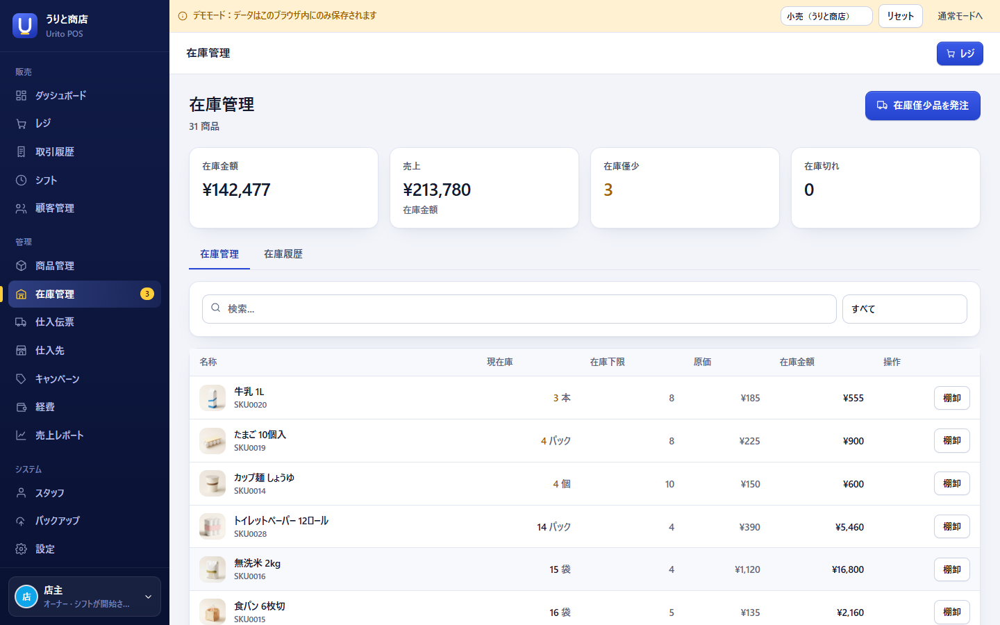
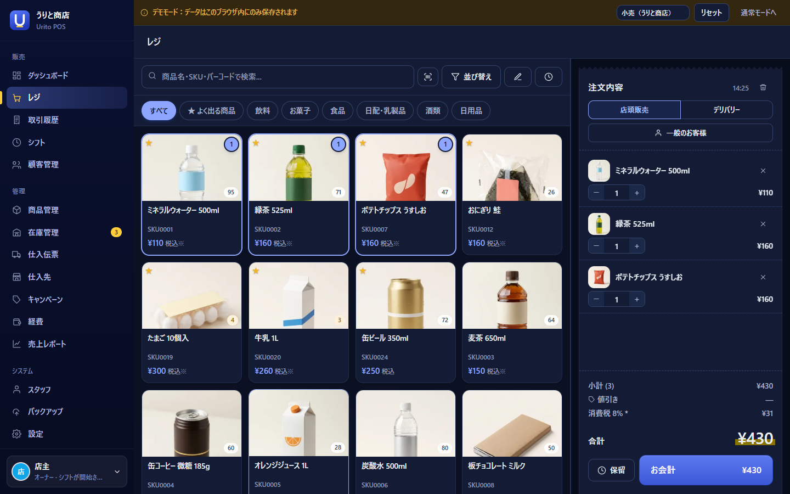
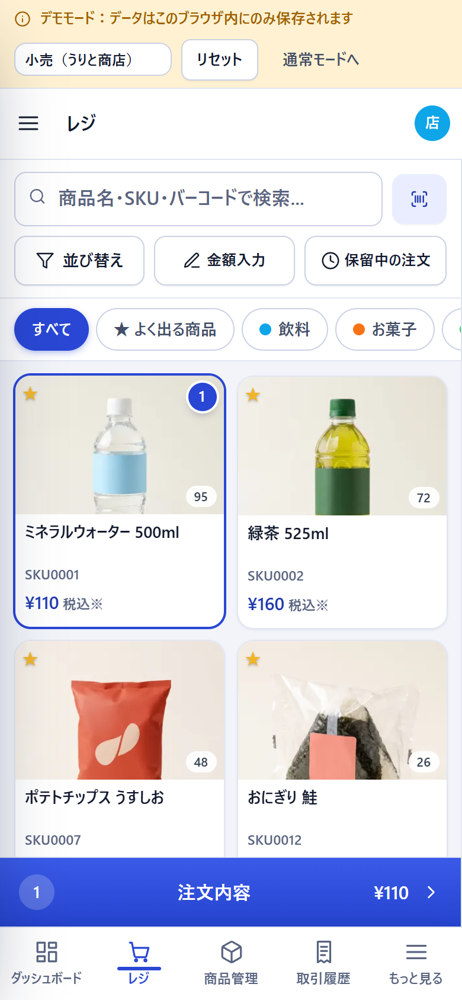

# Urito POS

[English](README.en.md) | [Tiếng Việt](README.vi.md) | [機能台帳](docs/ja/features.md) | [技術構成](docs/ja/architecture.md) | [実測ベンチマーク](docs/perf/benchmark.md)

## 概要

**Urito POS** は、小規模小売店・カフェ・飲食店向けの **完全オフライン動作・サーバー不要・月額費用 0 円** のブラウザ型 POS システム（PWA）です。  
外部サーバーやクラウド課金を一切挟まず、売上・商品マスタ・在庫履歴・顧客売掛金・シフト精算・レシート印字までをすべて端末内の IndexedDB に保存して動作します。

## デモ

ビルド後のショーケースサイト（`npm run build:showcase`）またはアプリ（`npm run dev` / `npm run preview`）に対して以下のデモクエリを付与すると、本番データベース（`urito`）と完全に隔離された `urito-demo` DB で 3 業種を試用できます。

- **小売店（うりと商店）**: `?demo=ja-retail#/pos`（`?demo=1` でも起動） — バーコード商品 12 品・軽減税率 8%/10% 混在・過去 30 日分の販売履歴
- **カフェ（喫茶うりと）**: `?demo=ja-cafe#/pos` — サイズ/トッピングオプション・店内飲食 10% / テイクアウト 8% 自動切替
- **飲食店（うりと食堂）**: `?demo=ja-restaurant#/pos` — テーブル配席・移動/合算・保留伝票・インボイス領収書

## スクリーンショット



| レシート（インボイス・8%軽減税率内訳） | 売上レポート（日次ロールアップ・チャート） | 在庫管理（共通在庫） |
| :---: | :---: | :---: |
|  |  |  |

| ダークテーマ POS | モバイル片手シート UI |
| :---: | :---: |
|  |  |

## 特長

- **完全ローカル永続化（IndexedDB / Dexie）**: 複数テーブルの売上・在庫増減・事前集計を単一 IndexedDB トランザクションで原子的に記録。
- **日本向け軽減税率・インボイス・領収書対応**: 標準 10%・軽減 8%・非課税の商品別設定、店内飲食時の税率自動切替、登録番号（`T`＋13桁半角数字）・`※` 印・税率別内訳付きサーマルレシート（80mm / 58mm）および 50,000 円以上で収入印紙枠を印字する `Ryoshusho`（領収書）を発行可能。
- **Shopify / EC 連携・多言語多通貨**: Shopify 商品 CSV の双方向入出力、`product.i18n`（ja/en/vi）および `product.prices`（JPY/USD/VND）管理、手動為替レート目安計算、`[channel+externalId]` による重複防止付き EC 受注取込と未一致 SKU 紐付け待ちキューを搭載。
- **厳格なオフライン PWA・ストリーミングバックアップ**: 実ファイル存在検証済みのキャッシュ優先 Service Worker、未会計カートがあるときの更新確認モーダル、File System Access API＋`CompressionStream('gzip')` による 500 件分割ストリーミング `.json.gz` と `images/` サブフォルダ差分同期を実装。

## 設計方針

1. **サーバーレス & 月額 0 円**: 小規模店の初期・継続固定費をゼロにするため、全業務状態をクライアント側 IndexedDB（Dexie v7 スキーマ）に完結させています。
2. **純粋関数＋整数最小単位（Integer Minor Units）**: 金銭計算・税計算・割引・返金ロジックは `src/core/` に純粋関数として隔離し、円・ドンは 1、ドルは 1 セント単位の整数で計算して浮動小数点誤差を排除しています。
3. **10万件規模での一定速度**: スキーマ v5 以降の事前集計テーブル（`dailyStats` / `dailyProductStats`）と商品画像テーブル分離（`productImages`）により、履歴が増えてもレジ起動と月次・年次レポートが遅くならない設計を採用しています。
4. **コメントとドキュメントの単一ソース**: 機能の一覧・状態は `src/features/registry.ts` のみで管理し、`npm run docs:features` で `docs/ja/features.md` とこの `README.md` を自動同期します。

## 技術スタック

- **フロントエンド**: React 19 / TypeScript 5.7 / Vite 6 / Zustand 5
- **データストア**: IndexedDB (`Dexie 4`) + 事前集計ロールアップテーブル (`v7`)
- **UI / 印刷 / チャート**: 自作 CSS トークン（Tailwind・MUI 等の外部 CSS フレームワーク不使用）、ネイティブ `<dialog>`（`showModal()` Top Layer）、自作 SVG アイコン・SVG チャート・Code 128 バーコード、サーマルレシート印刷用 `@media print`
- **品質検証**: Vitest 3 (`fake-indexeddb` + `fast-check` プロパティテスト) / ESLint (`jsx-a11y`, `react-hooks`) / Prettier / Playwright + Chrome CDP + `@axe-core/playwright`

## アーキテクチャ

詳細は [docs/ja/architecture.md](docs/ja/architecture.md) を参照してください。

```
src/
├── core/        # 純粋関数エンジン（cart, money, tax, refund, search, pin, date）
├── db/          # Dexie スキーマ (migrations v1..v7), opfs preUpgrade 退避, デモシード
├── services/    # トランザクション・永続化（orders, rollups, backup, ecImport, shopify）
├── store/       # Zustand 状態（app, cart, ui）
├── features/    # React.lazy 画面モジュール群と単一機能台帳 (registry.ts)
├── print/       # レシート / 領収書 (Ryoshusho) 印字レイアウト
├── lib/         # SVGバーコード, デコード時リサイズ, 300件LRU画像キャッシュ, SW制御
└── sw/          # キャッシュ優先 Service Worker テンプレート
```

## 性能（実測値）

詳細な計測条件・環境は [docs/perf/benchmark.md](docs/perf/benchmark.md) に保存されています（Chrome 156 headless / Playwright / CDP `CPUThrottlingRate: 4`）。

| データ規模 | POS初回起動 (4x CPU) | 6文字検索 | 10明細会計完了 | 会計中画像DB読取 | 年間レポート切替 | ストリーミングGzip出力 | 計測時JSヒープ |
|---|---:|---:|---:|---:|---:|---:|---:|
| 200商品・1,000注文 | 211 ms | 88 ms | 820 ms | 0 回 | 280 ms | 151 ms (80 KB) | 19.7 MB |
| 2,000商品・20,000注文 | 225 ms | 80 ms | 1,109 ms | 0 回 | 299 ms | 1,216 ms (1471.1 KB) | 37.4 MB |
| 5,000商品・100,000注文 | 340 ms | 127 ms | 944 ms | 0 回 | 288 ms | 6,060 ms (7233.1 KB) | 34.1 MB |

## テスト

- **単体・DB移行・プロパティテスト**: `npm test` — 21 ファイル・112 ケース（税端数境界、`fast-check` 増分集計不変条件、DB v1→v7 マイグレーション、PBKDF2 PIN、Gzip ストリーミング、EC CSV 取込）
- **オフライン・SW更新 E2E**: `node scripts/e2e/offline-sw.mjs` — オフライン再読込＋販売確定、待機中新バージョン検知〜未会計確認モーダル〜`SKIP_WAITING` 再起動を検証
- **アクセシビリティ監査**: `node scripts/e2e/a11y-audit.mjs` — POS / 取引履歴 / 商品管理 / 在庫管理 / レポート / 設定の 6 画面 × 2 画面幅（360px / 1440px）× Light / Dark 計 24 パターンで `axe-core` critical/serious 違反 0 件・横溢れ 0 件・`<dialog>` Esc 復帰を検証

## 対応ブラウザ

- **推奨（PC / Android）**: Google Chrome・Microsoft Edge 最新版（File System Access API によるフォルダ自動バックアップ、`BarcodeDetector`、OPFS、WebCrypto 全対応）
- **限定対応（iOS Safari 等）**: 会計・IndexedDB・Service Worker オフライン・ファイル手動ダウンロード/復元・レシート印刷は動作。ローカルフォルダ継続同期のみ未対応のため `.json.gz` / `.urito.json` 手動保存を利用します。

## 開発状況

<!-- FEATURES:START -->

| ID | 機能名 | 状態 | 導入バージョン | パス | 概要 |
|---|---|---|---|---|---|
| `pos` | レジ | 安定版 (stable) | v0.1 | `/pos` |  |
| `orders` | 取引履歴 | 安定版 (stable) | v0.1 | `/orders` |  |
| `products` | 商品管理 | 安定版 (stable) | v0.1 | `/products` |  |
| `inventory` | 在庫管理 | 安定版 (stable) | v0.2 | `/inventory` |  |
| `purchases` | 仕入伝票 | 安定版 (stable) | v0.2 | `/purchases` |  |
| `customers` | 顧客管理 | 安定版 (stable) | v0.2 | `/customers` |  |
| `shifts` | シフト | 安定版 (stable) | v0.2 | `/shifts` |  |
| `expenses` | 経費 | 安定版 (stable) | v0.3 | `/expenses` |  |
| `reports` | 売上レポート | 安定版 (stable) | v0.3 | `/reports` |  |
| `users` | スタッフ | 安定版 (stable) | v0.3 | `/users` |  |
| `backup` | バックアップ | 安定版 (stable) | v0.4 | `/backup` |  |
| `labels` | バーコードラベル印刷 | 安定版 (stable) | v0.4 | `/labels` |  |
| `tax-invoice` | 軽減税率・インボイス対応 | 安定版 (stable) | v0.6 | `/settings` | 商品別8%/10%・店内飲食切替・適格簡易請求書と領収書発行に対応します。 |
| `tables` | テーブル | ベータ (beta) | v0.3 | `/tables` |  |
| `camera-scan` | カメラバーコード読取 | ベータ (beta) | v0.4 | — | 対応ブラウザのカメラ（BarcodeDetector）でJAN・コードを読み取ります。 |
| `delivery` | 配送注文対応 | 開発中 (wip) | v0.5 | — | 配達先管理や配送ステータス追跡に対応予定です。 |
| `receipt-qr` | レシートQRコード印字 | 開発中 (wip) | v0.5 | — | レシート下部への決済QRコード印字を整備中です。 |
| `shopify-csv` | Shopify連携CSV出力 | 安定版 (stable) | v0.6 | `/products` | Shopify公式商品CSV形式での商品データの双方向インポート・エクスポートに対応します。 |
| `multilang-catalog` | 商品カタログ多言語・多通貨 | 安定版 (stable) | v0.6 | `/products` | 1商品ごとの多言語名・説明・通貨別価格の登録とレシート印字言語の切替に対応します。 |
| `ec-orders` | EC受注取込・共通在庫 | 安定版 (stable) | v0.6 | `/orders` | Shopify等の受注CSVを重複防止付きで取り込み、在庫引当と売上集計へ自動反映します。 |
| `other-ec-csv` | Shopline・Shopee CSV連携 | 計画中 (planned) | v0.7 | — | Shopline・Shopeeなど他社ECモールの受注・商品CSVフォーマット対応を予定しています。 |
| `romaji-search` | ローマ字商品検索 | 計画中 (planned) | v0.7 | — | ひらがな・カタカナに加えてローマ字入力での商品インクリメンタル検索を予定しています。 |

<!-- FEATURES:END -->

## セットアップ

```bash
npm install
npm run dev                  # 開発サーバー起動 (http://localhost:5173)
npm run typecheck            # TypeScript 型チェック
npm run lint                 # ESLint + jsx-a11y + react-hooks チェック
npx prettier --check src     # フォーマット検証
npm test                     # Vitest 全テスト実行
npm run build                # 通常（日本語既定・公開/PWA）ビルド
node scripts/check-size.mjs  # バンドルサイズ予算検証 (perf-budget.json)
npm run docs:features        # registry.ts -> docs/ja/features.md & README.md 更新
npm run build:showcase       # LP (site/) + POS (/app/) 統合ビルド -> dist-showcase/
npm run build:shop           # ベトナム実店舗向け --mode shop ビルド + Netlify ZIP 生成
```

## セキュリティ上の前提

- **店舗内運用モデル**: Urito は店舗内端末でのオフライン運用を前提としています。サーバー通信や外部認証局は存在しません。
- **PIN 認証の位置づけ**: スタッフ PIN は PBKDF2-SHA256（ランダム 16 バイトソルト・150,000 回反復）と 5 回連続誤入力時のロックアウトタイマー（30秒）で保護され、バックアップ出力時も平文・ハッシュ方針に従い平文 PIN は出力しません。ただしローカル端末上の IndexedDB 自体を直接開発者ツール等で操作できる物理アクセス者に対する OS レベルの暗号化はブラウザ／端末側ロックに依存します。
- **データ消失対策**: ブラウザ履歴削除や端末故障に備え、設定またはバックアップ画面からクラウド同期フォルダ（Google Drive / OneDrive 等）への自動バックアップまたは `.urito.json`（画像込み完全バックアップ）の定期保存を推奨します。

## ライセンス

[MIT License](LICENSE)

## 作者

Copyright (c) 2026 [Urito Contributors](LICENSE)
