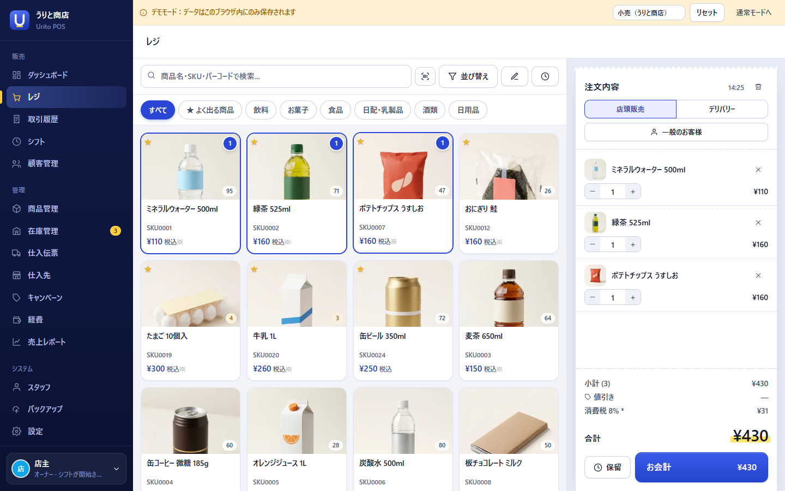

# Urito POS

[日本語](README.md) | [English](README.en.md) | [Bảng tính năng (JA)](docs/ja/features.md) | [Kiến trúc (JA)](docs/ja/architecture.md) | [Đo hiệu năng (JA)](docs/perf/benchmark.md)

## Giới thiệu

**Urito POS** là phần mềm quản lý bán hàng (**POS PWA mã nguồn mở**) hoạt động hoàn toàn trên trình duyệt cho cửa hàng bán lẻ, quán cà phê và nhà hàng nhỏ: **không cần máy chủ, không mất phí thuê bao hằng tháng, bán hàng bình thường ngay cả khi mất mạng**.  
Toàn bộ dữ liệu hoá đơn, sản phẩm, tồn kho, khách hàng, ca làm và thiết lập được lưu an toàn trong IndexedDB (`Dexie 4`).

## Dùng thử nhanh (Demo Mode)

Mở ứng dụng với tham số `?demo=<kịch bản>` để chạy trên cơ sở dữ liệu tách biệt `urito-demo` (không ảnh hưởng dữ liệu thật):

- **Cửa hàng bán lẻ**: `?demo=ja-retail#/pos` (hoặc `?demo=1`)
- **Quán cà phê**: `?demo=ja-cafe#/pos`
- **Quán ăn / Nhà hàng**: `?demo=ja-restaurant#/pos`

## Ảnh màn hình



## Điểm nổi bật & Kỹ thuật chính

- **Tốc độ ổn định ở quy mô 100.000 đơn hàng (đo thực tế giới hạn CPU 4 lần qua Chrome CDP)**:
  - **200 SP · 1.000 đơn**: khởi động POS `211 ms`, tìm kiếm `88 ms`, thanh toán 10 dòng `820 ms`, chuyển báo cáo năm `280 ms`
  - **5.000 SP · 100.000 đơn**: khởi động POS `340 ms`, tìm kiếm `127 ms`, thanh toán 10 dòng `944 ms` (`0` lần đọc ảnh DB), báo cáo năm `288 ms`, sao lưu Gzip stream `7.2 MB` giữ Heap ở `34.1 MB`
- **Chuẩn hoá đơn Nhật & Đa tiền tệ**: Thuế suất theo từng món (8% / 10% / miễn thuế), chuyển thuế ăn tại chỗ, số đăng ký kinh doanh `T`+13 số, phiếu thu `Ryoshusho` có khung tem thu nhập (`>= 50.000 JPY`), tỷ giá quy đổi tham khảo (JPY/USD/VND) và gợi ý giá bán ngoại tệ.
- **Đồng bộ Shopify & Nhập đơn EC**: Nhập/xuất CSV sản phẩm Shopify, nhập đơn hàng EC chống trùng theo `[channel+externalId]`, đối khớp SKU/mã vạch/tên đa ngôn ngữ và hàng chờ liên kết SKU chưa có trong kho.
- **Bảo mật & Sao lưu bền vững**: Mã PIN nhân viên băm PBKDF2-SHA256 (150.000 vòng lặp, khoá tạm 30s khi sai 5 lần), Service Worker cache-first nghiêm ngặt kèm cảnh báo khi giỏ hàng chưa thanh toán, sao lưu Stream Gzip (`.json.gz`), đồng bộ thư mục `images/` và xuất file đầy đủ kèm ảnh `.urito.json`.

## Lệnh phát triển & đóng gói

```bash
npm install
npm run dev                      # Máy chủ phát triển
npm run typecheck                # Kiểm tra TypeScript
npm run lint                     # ESLint + jsx-a11y + react-hooks
npm test                         # Toàn bộ kiểm thử Vitest (112 test)
npm run build                    # Build PWA chuẩn (mặc định tiếng Nhật + dist/sw.js)
npm run build:shop               # Build bản Việt hoá (--mode shop) + xuất file zip Netlify
npm run build:showcase           # Kết hợp trang giới thiệu LP (site/) + POS (/app/)
node scripts/e2e/offline-sw.mjs  # Kiểm thử E2E ngoại tuyến & cập nhật Service Worker
node scripts/e2e/a11y-audit.mjs  # Kiểm tra truy cập WCAG qua axe-core (24 tổ hợp)
```

## Giấy phép

[MIT License](LICENSE) — Copyright (c) 2026 Urito Contributors
